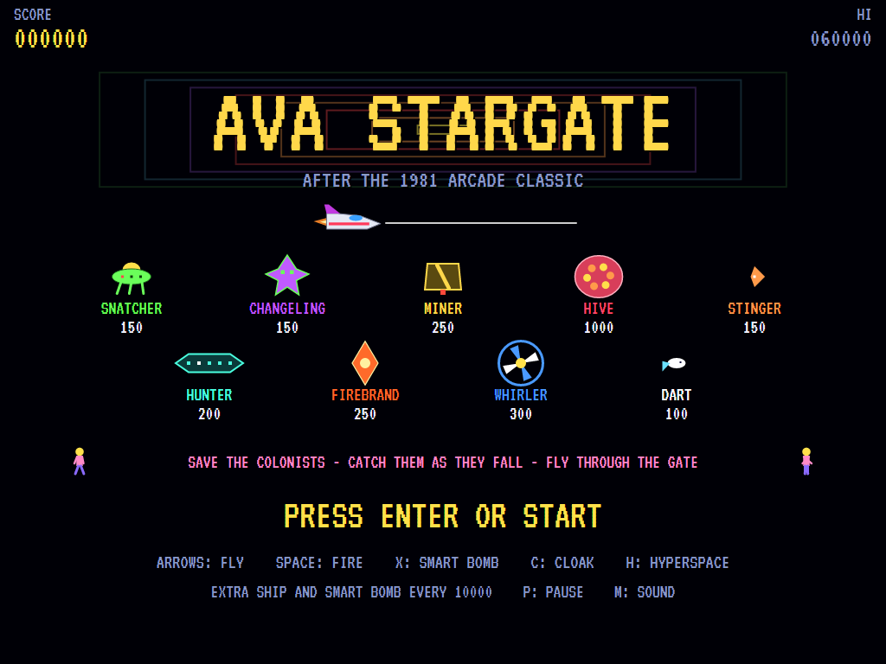
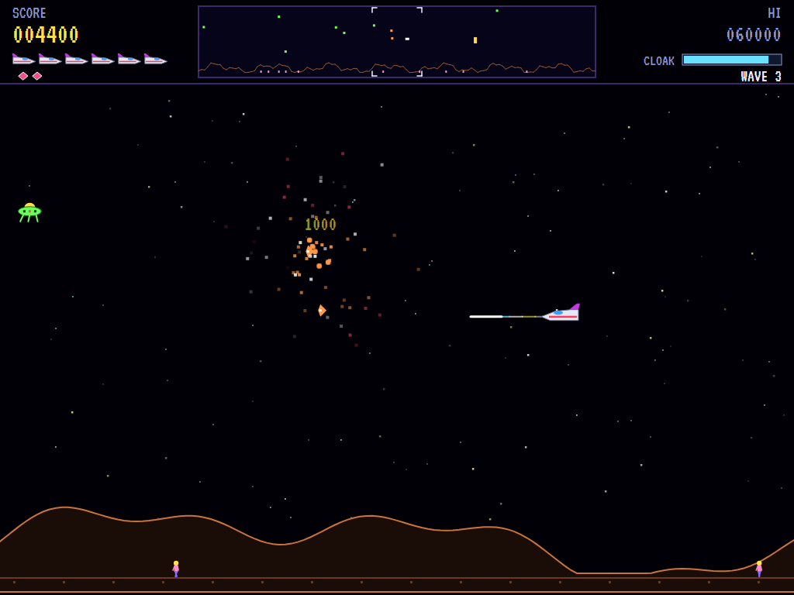
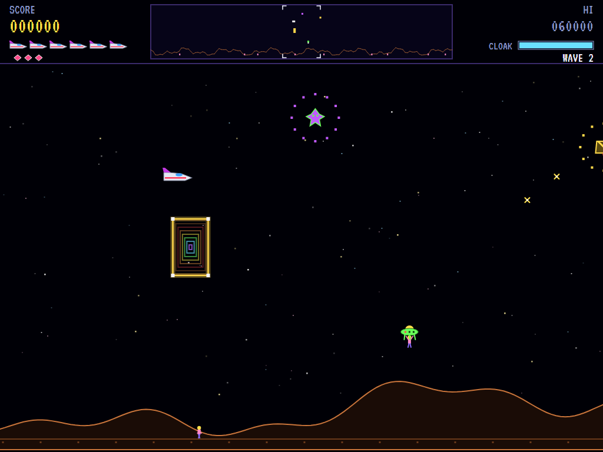
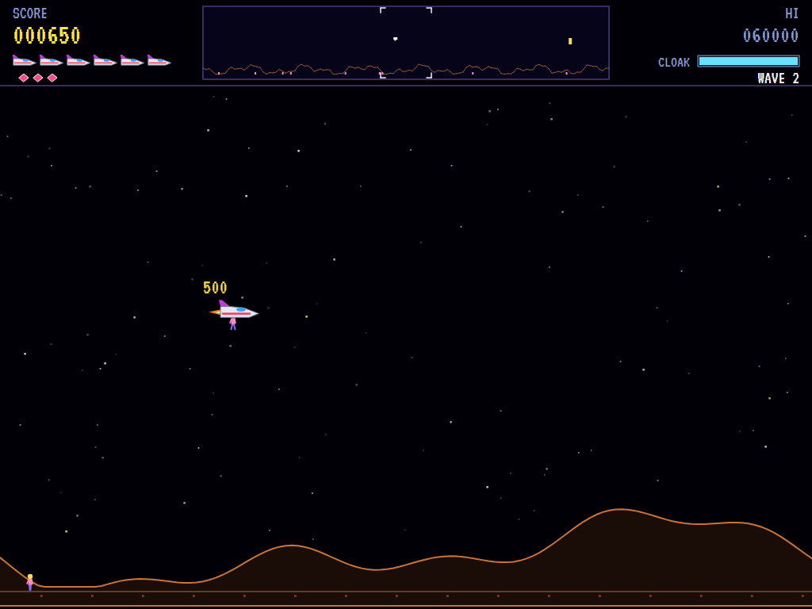
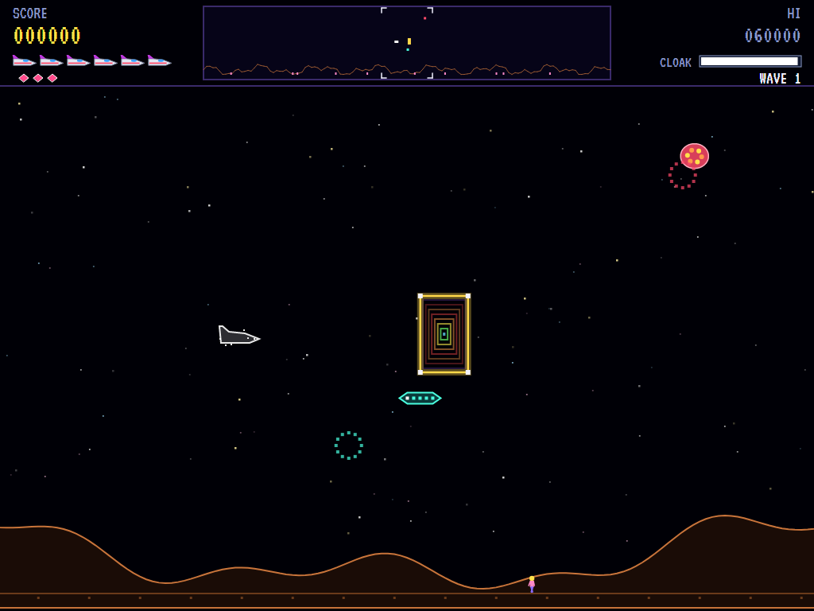
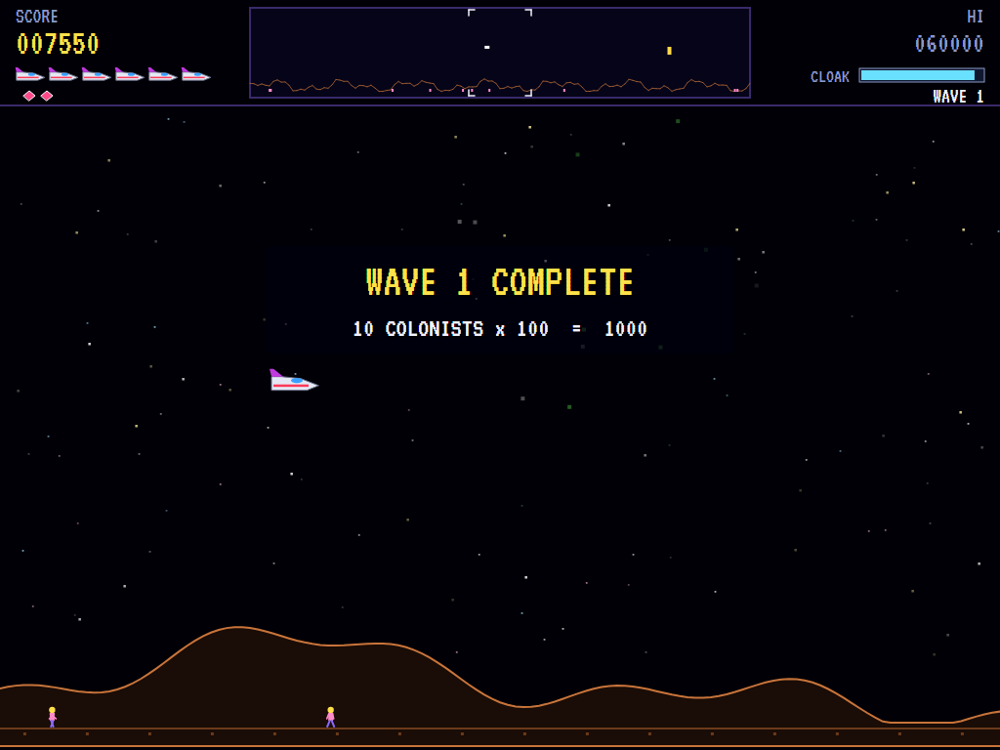
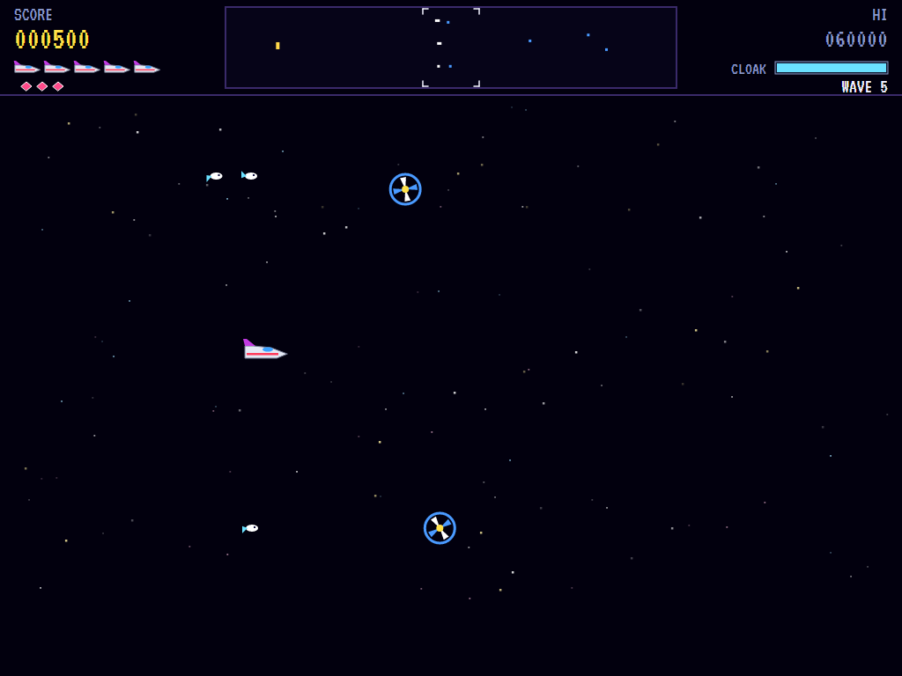
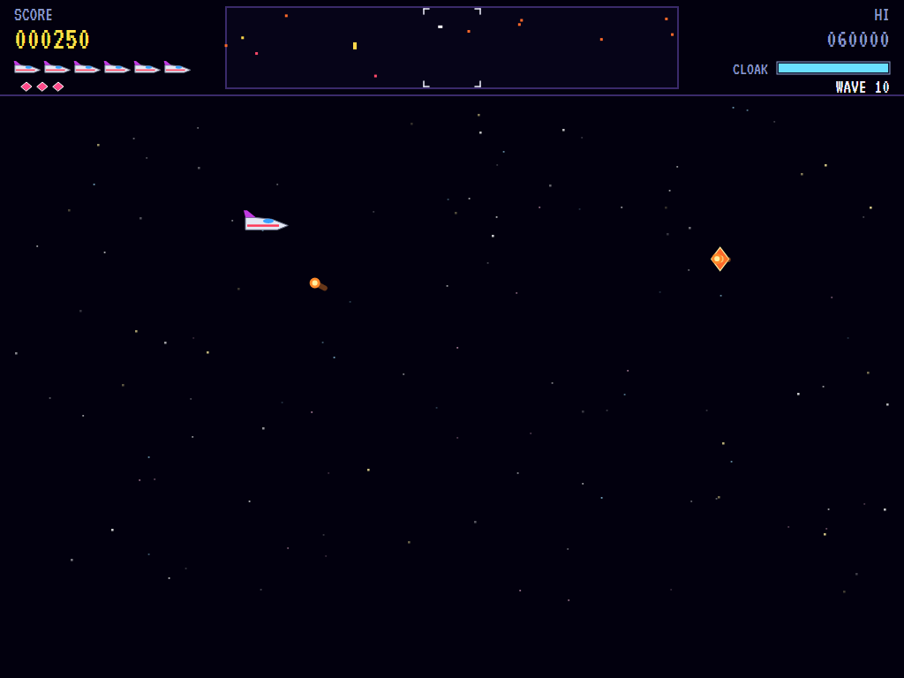
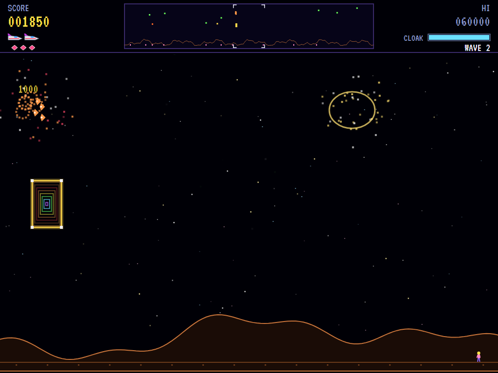
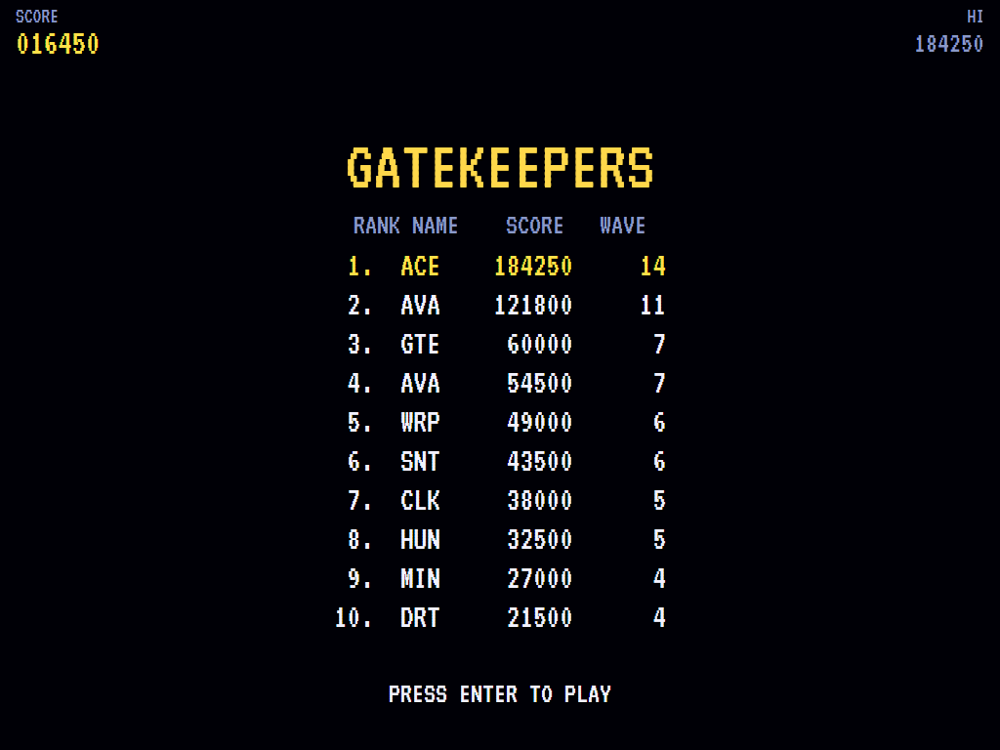

# AVA Stargate

[](https://github.com/Harlock123/AVAStargate/actions/workflows/build.yml)

A side-scrolling planet-defence shooter in the style of Williams' 1981 arcade game **Stargate**, built
with .NET 10 and Avalonia UI. Fly low over a planet that wraps round, eight screens wide. Snatchers come
down to carry its colonists off, and any that get away become Changelings. Shoot the Snatchers, catch the
colonists as they fall, and put them down safely. The scanner shows you the whole planet. When it gets
too much, use a smart bomb, the cloak, hyperspace or the gate.

## Features

- **Your ship**:
  - **Flying:** it races left or right with momentum and coasts when you let go. It slides across the screen when it turns round, so you can always see ahead.
  - **The laser:** a streak that flashes out level from the nose, flickering through the colours, and stops at the first thing in its way. Tap the trigger to fire quickly; hold it and it fires more slowly. Four streaks at most are in the air at once.
  - **Smart bombs:** destroy everything on the screen, shots and mines included. You start with three.
  - **The cloak:** while you hold it, nothing can hurt the ship, and anything it touches is destroyed. It drains fast, and each wave gives back some of its charge.
  - **Hyperspace:** throws the ship somewhere else on the planet at once. Now and then it never comes out the other side.
- **The gate**: a golden frame hanging over the planet. Fly through it to be thrown beside the Snatcher carrying a colonist highest. If nobody is in trouble, it sends you round to the far side of the planet. Fly through with **four or more colonists aboard** and it warps you **three waves ahead**, with 1,000 points for each colonist.
- **The colonists**:
  - **Ten of them** walk the ground below the mountains.
  - **Snatched:** a Snatcher drops down, takes hold of one, and climbs. If it reaches the top of the sky, the colonist is lost and the Snatcher becomes a Changeling.
  - **Rescued:** shoot a Snatcher and its colonist falls. Catch them in mid-air (500), and take them down to the ground (500 more). Your ship can carry several at once. A short fall they survive (250); a long one they don't.
  - **The planet lost:** lose every colonist and the planet is gone. Every Snatcher becomes a Changeling until the planet is restored, every fifth wave.
- **The enemy**:
  - **Snatcher:** a green saucer with grabbing claws. It cruises along, picks a colonist and goes down for them.
  - **Changeling:** a Snatcher that got its colonist away. Fast, jittery and always closing on you.
  - **Miner:** drifts across, sowing mines behind it.
  - **Hive:** slow and swollen. Shoot it and its **Stingers** pour out and swoop at you.
  - **Hunter:** sent when a wave drags on. It's as quick as your ship, hangs about off your nose or tail, and fires and fires.
  - **Firebrand:** zigzags across, lobbing fireballs that curl after the ship.
  - **Whirler:** a spinning top from deep space. It takes three hits and keeps hatching **Darts**, little fish that home in on you.
  - **Fair shots:** enemies only fire from on the screen, mostly leading their aim.
- **Waves**:
  - **Over the planet:** the Snatchers come in fives, with Miners, Hives and later Firebrands. Each wave sends more.
  - **Deep space:** waves 5, 15, 25 and so on are a **Whirler swarm**; waves 10, 20 and so on are a **Firebrand showdown**. There is no planet and no colonists, just the fight.
  - **Wave bonus:** at the end of each wave, every colonist left is worth 100 times the wave number, up to 500 each. A deep-space wave pays a flat bonus.
- **Scoring**:

  | | Points |
  |---|---|
  | Snatcher, Changeling, Stinger | 150 |
  | Hunter | 200 |
  | Miner, Firebrand | 250 |
  | Whirler | 300 |
  | Dart | 100 |
  | Hive | 1,000 |
  | Catching a colonist / setting them down | 500 / 500 |
  | Warping ahead through the gate | 1,000 per colonist aboard |

  - **Every 10,000 points** brings an extra ship and an extra smart bomb.
- **The scanner**: the whole planet across the top of the screen, with the mountains, the colonists, the gate, every enemy and your ship, and a bracket round what's on screen.
- **Sound**:
  - **The title tune:** an original racing anthem in D minor.
  - **The effects:** the laser's zing, explosions large and small, enemies materialising, a colonist's scream as they fall, the chime of a catch, the smart bomb's blast, the swoop of hyperspace, the cloak's shimmer, the rush of the gate, and the engine's throb.
  - All of it is synthesised and mixed by OpenAL.
- **Attract mode**: leave the title alone for 15 seconds and a computer pilot plays. It climbs and dives out of the way of shots, cloaks or smart-bombs when it must, catches falling colonists and sets them down, and goes after Snatchers carrying someone off first.
- **A top-ten high-score table** with arcade-style initials entry. It records the wave reached.
- **Gamepads** through SDL2, as well as the keyboard.
- **Any window size**: the screen scales to fit, letterboxed. **Ctrl+S** saves a screenshot.
- **One self-contained executable** per platform: Windows, macOS and Linux on Intel/AMD and ARM.

## Screenshots

| The title | Over the planet | Snatched |
|:---------:|:---------------:|:--------:|
|  |  |  |
| The enemy and what they're worth. | A Hive bursts into Stingers. | A Snatcher climbing away with a colonist. |

| A rescue | The gate | Wave complete |
|:--------:|:--------:|:-------------:|
|  |  |  |
| A colonist caught and set down. | Cloaked, on the way to the gate. | The bonus for the colonists left. |

| Whirler swarm | Firebrand showdown | Shot down |
|:-------------:|:------------------:|:---------:|
|  |  |  |
| Deep space, Darts hatching. | Fireballs curling after the ship. | One shot too many. |

| The gatekeepers | | |
|:---------------:|:-:|:-:|
|  | | |
| The high-score table. | | |

The screenshots are made by the tests, which play the game in a real (headless) window; see
[Tests](#tests).

## Download and run

Ready-to-run builds for Windows, macOS and Linux, on both Intel/AMD and ARM, are on the
[Releases page](https://github.com/Harlock123/AVAStargate/releases/tag/latest). **Latest build** is
rebuilt on every push to `main`. Each download is one self-contained executable: no .NET install is
needed.

| Platform | Archive |
|---|---|
| Windows | `AVAStargate-win-x64.zip`, `AVAStargate-win-x86.zip`, `AVAStargate-win-arm64.zip` |
| macOS | `AVAStargate-osx-arm64.tar.gz` (Apple silicon), `AVAStargate-osx-x64.tar.gz` (Intel) |
| Linux | `AVAStargate-linux-x64.tar.gz`, `AVAStargate-linux-arm64.tar.gz`, `AVAStargate-linux-arm.tar.gz` |

```bash
tar -xzf AVAStargate-linux-x64.tar.gz     # or linux-arm64, linux-arm, osx-arm64, osx-x64
./AVAStargate
```

On Windows, unzip and run `AVAStargate.exe`. On macOS, if Gatekeeper refuses to open it, run
`xattr -d com.apple.quarantine AVAStargate` once. Run with `--no-audio` for silence.

**Sound** comes through OpenAL Soft, built in for every platform. In a virtual machine the game
detects it and uses a larger audio buffer, so the sound doesn't break up.

**Gamepads** use SDL2, which is bundled for Windows, macOS and Intel/AMD Linux. ARM Linux builds need it
installed; without it the keyboard still works:

```bash
sudo apt install libsdl2-dev            # Debian / Ubuntu / Raspberry Pi OS
sudo pacman -S --needed sdl2-compat     # Arch / Omarchy
```

## Controls

| Input | Action |
|-------|--------|
| **Enter** | Start |
| **Left** / **Right** (or **A** / **D**) | Fly that way (the ship turns to face it) |
| **Up** / **Down** (or **W** / **S**) | Climb / dive |
| **Space** / **Z** / **Ctrl** | Fire (tap for quicker fire) |
| **X** / **B** | Smart bomb |
| **C** / **V** | Cloak (hold) |
| **H** / **Q** | Hyperspace |
| **P** / **Esc** | Pause (Esc again to quit) |
| **M** | Mute |
| **Ctrl+S** / **Cmd+S** | Save a screenshot to the Pictures folder |

**Gamepad**: left stick or D-pad to fly, **A** or the right trigger to fire, **B** for a smart bomb,
**X** or the left trigger to cloak, **Y** for hyperspace, **Start** to start and pause, **Back** (while
paused) to quit.

**Entering initials**: type letters, or dial with **Up**/**Down** and accept with **Space**; **Left** /
**Backspace** go back; **Enter** finishes.

## Tests

```bash
dotnet test AVAStargate.slnx
```

The engine has no UI and runs in fixed 60 Hz steps, so it plays the same at any frame rate, and a seed
always plays the same game. The tests check:

- **The ship:**
  - flying either way, coasting, and sliding across the screen
  - climbing and diving between the scanner and the ground
  - the planet wrapping round
  - the laser stopping at the first thing level and ahead
  - quick tapping, and four streaks at most
  - smart bombs clearing the screen but nothing off it
  - the cloak's shield and its charge running out
  - hyperspace, and now and then losing the ship in it
- **The gate:**
  - being thrown to the colonist in most danger
  - going round the far side otherwise
  - warping three waves ahead with four colonists aboard
- **The colonists:**
  - a Snatcher carrying one to the top and becoming a Changeling
  - a long fall killing them, and a short one not
  - catching one and setting them down
  - dropping them when the ship is lost
  - the planet lost, and restored five waves on
- **The enemy:**
  - Hives bursting into Stingers
  - Miners sowing mines
  - Whirlers taking three hits and hatching Darts
  - a Hunter coming when the wave drags on
  - only what's on the screen firing
- **Losing ships:** rammed and shot down, the moment's safety after coming back, and the last ship ending the game
- **Waves:**
  - the bonus for the colonists left
  - the deep-space waves
  - bigger waves later
  - an extra ship and smart bomb every 10,000
- **The machine:** the attract cycle, the computer pilot beating the first waves and rescuing colonists, the same game from the same seed, and pausing

The screenshot tests draw the real screen in a headless window. To refresh the README's pictures:

```bash
GATE_SHOTS=$PWD/Images dotnet test tests/AVAStargate.Tests --filter ScreenshotTests
```

To see how the computer pilot gets on, wave by wave (for tuning), or how a player who just bobs up and
down firing does (`GATE_PROBE=lazy`):

```bash
GATE_PROBE=1 dotnet test tests/AVAStargate.Tests --filter PilotProbe --logger "console;verbosity=detailed"
```

## Building

```bash
dotnet build AVAStargate.slnx
dotnet run --project src/AVAStargate
```

Needs the .NET 10 SDK. The sounds are made by `tools/make_sounds.py` (standard-library Python):
`python3 tools/make_sounds.py` rewrites `src/AVAStargate/Sounds`.

## Project structure

```
AVAStargate/
├── AVAStargate.slnx
├── src/AVAStargate/
│   ├── Engine/
│   │   ├── GameEngine.cs        # States, the title and demo cycle, and the engine's throb
│   │   ├── GameEngine.Play.cs   # The ship, its laser, smart bombs, cloak and hyperspace; the gate;
│   │   │                        # the colonists; the nine kinds of enemy; waves and scoring
│   │   ├── ShipPilot.cs         # The computer pilot, for the demonstration (and the tests)
│   │   ├── Entities.cs          # The wrapping planet and its mountains, the ship, lasers, shots,
│   │   │                        # colonists, enemies and the gate
│   │   ├── HighScoreTable.cs, InitialsEntry.cs
│   │   ├── InputHandler.cs, ControllerManager.cs  # Keys and an SDL2 gamepad
│   │   └── SoundManager.cs      # Effects and the tunes through OpenAL
│   ├── Audio/                   # The OpenAL engine (from the author's AVABand)
│   ├── Views/                   # The scrolling planet, the scanner, the ship, the enemy, the screens
│   └── Sounds/                  # The synthesised effects and tunes
├── tests/AVAStargate.Tests/     # Gameplay, screenshot and probe tests
├── tools/make_sounds.py
└── Images/                      # Screenshots
```

## About and licence

AVA Stargate © 2026 Lonnie Watson, under the [MIT License](LICENSE).

*Stargate* © 1981 Williams Electronics; the name belongs to its current owner. AVA Stargate is an
independent, unofficial game in its style. Its ship, its colonists, its Snatchers, Changelings, Miners,
Hives, Stingers, Hunters, Firebrands, Whirlers and Darts, its gate, its graphics, sounds, tunes and code
are its own; nothing is taken from the arcade machine's program, graphics, sound or music. It is not
affiliated with or endorsed by any rights holder.
